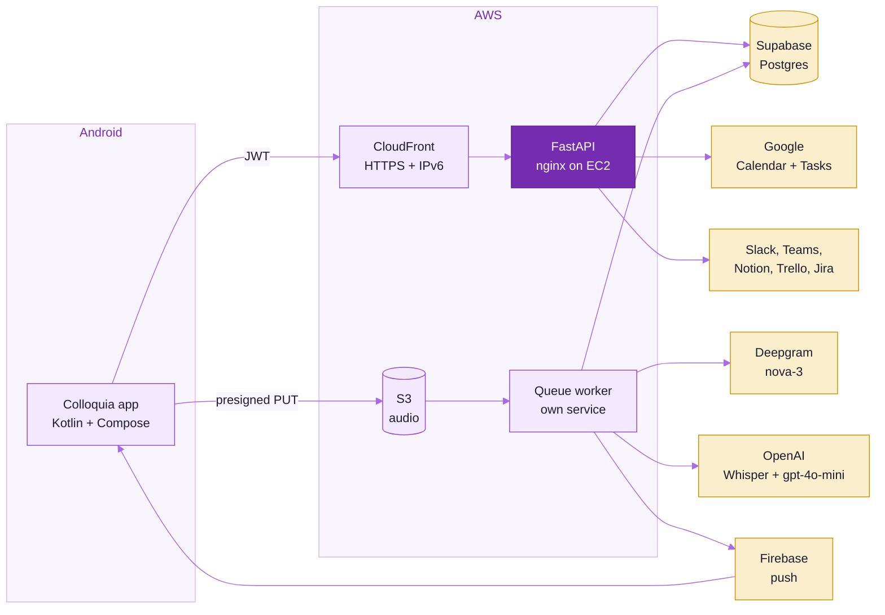
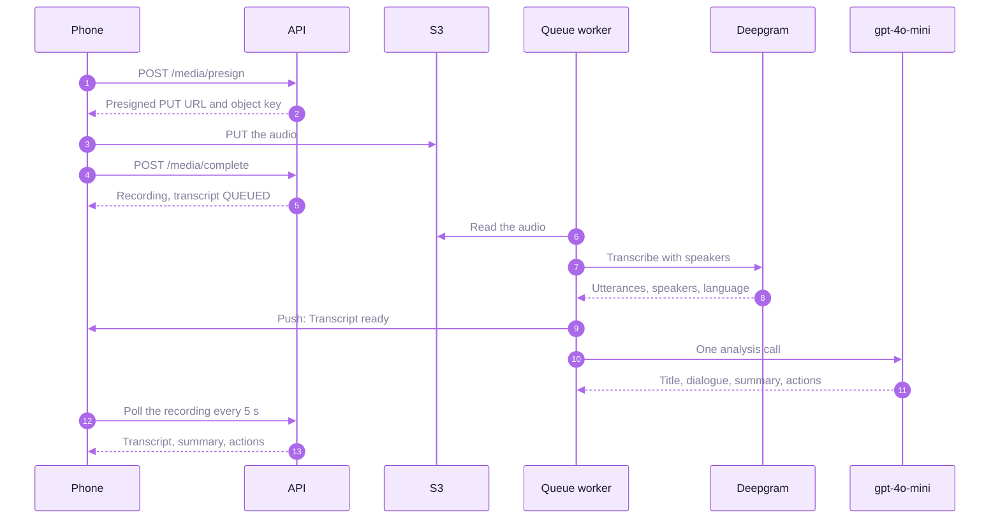

<picture>
  <source media="(prefers-color-scheme: dark)" srcset="docs/readme-kit/assets/hero-dark.svg">
  
</picture>

<p align="center">
  <picture>
    <source media="(prefers-color-scheme: dark)" srcset="https://readme-typing-svg.demolab.com?font=Plus+Jakarta+Sans&weight=600&size=20&duration=2800&pause=900&color=C090F5&center=true&vCenter=true&width=760&lines=Record+a+conversation+on+your+phone;Know+who+said+what%2C+across+languages;A+summary%2C+decisions+and+action+items;Send+them+to+Calendar%2C+Tasks+or+Slack;Nothing+lost+when+the+signal+drops">
    
  </picture>
</p>

<p align="center">
  
  
  
  
  
  <a href="https://github.com/cxacraftecosystem-ui/Colloquia/actions/workflows/ci.yml"></a>
</p>

**Colloquia** is a recording and transcription app for a closely knit academic community. A meeting,
talk or conversation recorded on Android comes back as a transcript that knows who spoke, even when
they switch languages mid-conversation, with a clean dialogue, an English copy, a summary and the
action items, decisions and deadlines it held. Those go on to Google Calendar and Tasks, Slack, Teams,
Notion, Trello, Jira or any webhook, and every transcript can be searched and questioned later.

<picture>
  <source media="(prefers-color-scheme: dark)" srcset="docs/readme-kit/assets/stats-dark.svg">
  
</picture>

<picture>
  <source media="(prefers-color-scheme: dark)" srcset="docs/readme-kit/assets/divider-dark.svg">
  
</picture>

## &nbsp; What it does

<picture>
  <source media="(prefers-color-scheme: dark)" srcset="docs/readme-kit/assets/cards-dark.svg">
  
</picture>

| Feature | Where it lives | Read more |
|---|---|---|
| Record with pause and resume, in the background, with a live level meter | `android/.../recording/RecorderController.kt`, `RecorderService.kt` | [Architecture](docs/ARCHITECTURE.md#1-system-context) |
| Import audio, or video whose audio track is copied out on the phone without re-encoding | `recording/AudioExtract.kt`, `AppViewModel.importMedia` | [Architecture](docs/ARCHITECTURE.md#2-from-recording-to-transcript) |
| Offline outbox for every upload that fails | `data/Offline.kt`, `data/Repository.kt` | [The outbox](docs/ARCHITECTURE.md#3-the-offline-outbox) |
| Speaker-labelled, multilingual transcription | `backend/app/services/ai.py`, `services/media_queue.py` | [Providers](docs/ARCHITECTURE.md#5-transcription-providers) |
| Title, clean dialogue, English copy, summary and extractions in one AI call | `ai.analyze_full` | [Analysis](docs/ARCHITECTURE.md#6-analysis) |
| Library with search, sort, folders, tags, favourites, pins and archive | `api/routes/recordings.py`, `ui/LibraryScreen.kt` | |
| Transcript as speaker turns or timestamped lines, tap to play, inline edits, speaker rename, 0.75x to 2x playback | `ui/DetailScreen.kt`, `ui/AudioPlayer.kt` | |
| Chat with a transcript, ask across all of them, search | `api/routes/ai.py`, `api/routes/knowledge.py`, `ui/AskScreen.kt` | [Analysis](docs/ARCHITECTURE.md#6-analysis) |
| Export as TXT, Markdown, Word or PDF, copy and share | `services/export.py` | |
| Calendar, Tasks, Slack, Teams, Notion, Trello, Jira and webhooks | `services/integrations.py`, `services/google_productivity.py`, `ui/IntegrationsScreen.kt` | [Feature status](docs/DEFERRED.md) |
| Push when a transcript is ready | `services/fcm.py`, `push/ColloquiaMessagingService.kt` | |
| Over-the-air updates published from the master admin's phone | `api/routes/app_release.py`, `ui/SettingsScreen.kt` | |

<picture>
  <source media="(prefers-color-scheme: dark)" srcset="docs/readme-kit/assets/divider-dark.svg">
  
</picture>

## &nbsp; How it works

<picture>
  <source media="(prefers-color-scheme: dark)" srcset="docs/readme-kit/assets/pipeline-dark.svg">
  
</picture>

The Android app calls one FastAPI service behind CloudFront, with a JWT on every request. Audio never
passes through the API: the app asks for a presigned URL, puts the file straight into S3, then confirms
with `/media/complete`, which creates the recording and queues a transcription job. A separate queue
worker transcribes it, sends a push and chains one analysis job, so no request waits on a model.



| Layer | What runs there | Where it is described |
|---|---|---|
| Android | Kotlin and Jetpack Compose, `com.transcriptai.app`, min SDK 26, target SDK 35; Retrofit over OkHttp, Media3 for playback, Credential Manager for Google sign-in | [android/app/build.gradle.kts](android/app/build.gradle.kts) |
| Edge | CloudFront with HTTPS and IPv6, nothing cached, a 60-second origin read timeout, plain HTTP to the box | [infra/CLOUDFRONT.md](infra/CLOUDFRONT.md) |
| API | FastAPI as one uvicorn process on `127.0.0.1:8010` behind nginx, systemd unit `colloquia` | [ARCHITECTURE.md](docs/ARCHITECTURE.md#1-system-context) |
| Queue | `python -m app.worker` as its own unit, `colloquia-queue`, draining `ta_processing_jobs` | [ARCHITECTURE.md](docs/ARCHITECTURE.md#4-the-queue) |
| Data | Supabase Postgres through Prisma, every table named `ta_*` beside the field repository's; audio in S3 under `media/<user>/<uuid>/` | [ARCHITECTURE.md](docs/ARCHITECTURE.md#7-data-model) |
| Box | Terraform: one EC2 instance (`t3.micro` by default) in `ap-south-1`, an Elastic IP, a security group and the CloudFront distribution | [infra/terraform](infra/terraform) |

### From recording to transcript



`/media/complete` is idempotent on the object key, so a retried or timed-out call returns the same
recording and never drops its transcription. The detail screen polls every five seconds while the
transcript is in flight, then for up to three more minutes until the analysis lands. When an upload
fails, the file stays on the phone in the [outbox](docs/ARCHITECTURE.md#3-the-offline-outbox).

<picture>
  <source media="(prefers-color-scheme: dark)" srcset="docs/readme-kit/assets/divider-dark.svg">
  
</picture>

## &nbsp; Transcripts and AI

Deepgram is tried first whenever a key is set: nova-3 with `language=multi` follows speakers who switch
language mid-conversation and tags each utterance, nova-2 with language detection answers if the account
refuses nova-3, then the account default. Any other Deepgram error falls back to OpenAI Whisper
(`whisper-1`), which splits files over 24 MB into ten-minute mono chunks. Whisper gives timestamps but no
speakers; the analysis pass then writes the dialogue with **Speaker N** labels.

| Feature | When it runs | Model | On Android |
|---|---|---|:---:|
| Transcript with timestamps, speakers and language | queue | Deepgram nova-3 (nova-2 or the account default if refused); Whisper on any other error | ✓ |
| Title, clean dialogue, English copy, brief summary, action items, decisions, takeaways, deadlines, entities, keywords, topics | queue, one call after the transcript | `gpt-4o-mini` in JSON mode | ✓ |
| Detailed, bullet and minutes summaries | on demand | `gpt-4o-mini` | ✓ |
| Chat with one transcript, kept per recording | on demand | `gpt-4o-mini` | ✓ |
| Translate, rewrite, change tone, custom prompt | on demand | `gpt-4o-mini` | ✓ |
| Ask across recordings | on demand | `gpt-4o-mini` over the closest passages, or the three latest transcripts in lite mode | ✓ |
| Search | on demand | `text-embedding-3-small` with lite mode off, a keyword match with it on | ✓ |
| Weekly or daily digest | on demand | `gpt-4o-mini` | ✓ |
| Meeting coaching, conversation analytics, voice-command intent | on demand | `gpt-4o-mini` | · |
| Productivity numbers, knowledge graph of entities and topics | on demand | none, counted from stored items | · |
| Live transcription over a WebSocket | streaming, refused in lite mode | the same speech chain | · |

Deadlines come out as ISO dates: the prompt carries the current date and time in `APP_TIMEZONE`
(Asia/Kolkata by default), so "next Thursday" lands on the right day. The master admin picks the
transcript mode for everyone: `REFINED_TRANSLATED` also writes the English copy, `RAW` and `REFINED`
keep the dialogue in its own language. When the OpenAI account is out of quota, the AI routes answer
HTTP 402, the app says so plainly, analysis jobs wait and retry every 15 minutes, and
`GET /health/ai` reports whether the key works.

<picture>
  <source media="(prefers-color-scheme: dark)" srcset="docs/readme-kit/assets/divider-dark.svg">
  
</picture>

## &nbsp; Integrations

| Destination | Connects with | Sends | On Android |
|---|---|---|:---:|
| Google Calendar | the phone's Google access token for `calendar.events`, relayed per request | one hour-long event per action item and deadline, on its due date or tomorrow | ✓ |
| Google Tasks | the phone's access token for `tasks` | one task per action item, with its due date | ✓ |
| Gmail | an access token for `gmail.compose` | a draft with the detailed summary and the action items | · |
| Slack, Microsoft Teams | an incoming webhook URL | title, summary and action items | ✓ |
| Notion | an integration token and a database ID | a page in the database | ✓ |
| Trello | an API key, a token and a list ID | a card on the list | ✓ |
| Jira | the site URL, an account email, an API token and a project key | a Task issue | ✓ |
| Any webhook | a URL | `{"text": ...}` as JSON | ✓ |
| Automation rules | rules each user sets, run after every analysis | the same pushes to Slack, Teams, Notion, Trello, Jira or a webhook | · |
| Push notifications | FCM HTTP v1 with a Firebase service account on the server | "Transcript ready" to each of the owner's registered devices | ✓ |

The backend keeps no Google refresh tokens: the phone asks for the Calendar and Tasks scopes when the
user first sends, and passes a short-lived access token with each request. Tokens and webhook URLs for
the other destinations are saved per user in `ta_integrations` from the Connections screen, and a
recording's menu has **Send to connection**. The Gmail and Google Meet rows on that screen show the
Google link only; the Gmail draft route has no button yet and Meet ingestion is not built.

<picture>
  <source media="(prefers-color-scheme: dark)" srcset="docs/readme-kit/assets/divider-dark.svg">
  
</picture>

## &nbsp; Sign-in and roles

| Sign-in | How it works |
|---|---|
| Email and password | bcrypt hashes; accounts are made by `backend/scripts/seed_admin.py`, there is no sign-up |
| Google | a Credential Manager ID token, verified against `GOOGLE_CLIENT_ID` or `GOOGLE_ANDROID_CLIENT_ID` |
| Microsoft | an authorization code from the browser, exchanged by the backend; tenant `common` unless `MICROSOFT_TENANT` says otherwise |
| Yahoo | the same, through `/api/auth/yahoo/callback`, which bounces the code to `com.transcriptai.app://oauth` because Yahoo refuses custom schemes |

Every sign-in returns an HS256 JWT that lasts seven days by default (`JWT_EXPIRES_MINUTES`). A first
Google, Microsoft or Yahoo sign-in creates the account.

| Role | Who | Can |
|---|---|---|
| `USER` | everyone else | their own recordings, folders, tags, integrations and settings |
| `ADMIN` | the account `seed_admin.py` makes, unless it is the master address | + open any user's recordings, folders and tags |
| `MASTER_ADMIN` | the `MASTER_ADMIN_EMAIL` address | + set the transcript mode and off-peak window for everyone, and publish an app update to every phone |

## &nbsp; Built with

<p align="center">
  <picture>
    <source media="(prefers-color-scheme: dark)" srcset="https://skillicons.dev/icons?i=kotlin,androidstudio,py,fastapi,postgres,prisma,supabase,aws,terraform,nginx,firebase,githubactions&theme=dark&perline=12">
    
  </picture>
</p>

| Layer | Stack |
|---|---|
| Android | Kotlin 2.0.21, Android Gradle Plugin 8.7.3, Compose BOM 2024.10.01 with Material 3, Navigation Compose, Media3 ExoPlayer 1.4.1, Retrofit 2.11 with kotlinx.serialization, Credential Manager 1.6, Play Services Auth, Firebase Messaging |
| Look | an editorial theme after the [ElevenLabs design analysis](docs/DESIGN-elevenlabs.md): off-white canvas, warm near-black ink, EB Garamond for display and Inter for text, both bundled |
| API | FastAPI, uvicorn, Pydantic Settings, Prisma Client Python (asyncio), python-jose, passlib with bcrypt, boto3, google-auth, pydub with ffmpeg, python-docx, ReportLab |
| Data | Supabase Postgres through its transaction pooler (`:6543`, `pgbouncer=true`) by default; S3 through its dual-stack regional endpoint |
| Infra | Terraform, nginx, systemd, GitHub Actions |

## &nbsp; Quick start

These are the steps for running the stack on a Windows development machine. CI builds and deploys on
GitHub Actions.

1. Set up the backend. Copy `backend/.env.example` to `backend/.env` and fill it in first; the
   [configuration table](docs/ARCHITECTURE.md#8-configuration) lists every variable.

   ```powershell
   cd backend
   python -m venv .venv; .\.venv\Scripts\Activate.ps1
   pip install -e .
   $env:PATH = "$PWD\.venv\Scripts;$env:PATH"
   python -m prisma generate --schema=prisma/schema.prisma
   ```

2. Create the `ta_*` tables. The files are additive and never touch another app's tables; apply them in
   the order the deploy does. Never use `prisma db push` (it fails here with P1014) or `prisma migrate`
   (it would touch the shared `_prisma_migrations`).

   ```powershell
   python -m prisma db execute --schema=prisma/schema.prisma --file prisma/create_tables.sql
   python -m prisma db execute --schema=prisma/schema.prisma --file prisma/phase2_tables.sql
   python -m prisma db execute --schema=prisma/schema.prisma --file prisma/app_release_table.sql
   python -m prisma db execute --schema=prisma/schema.prisma --file prisma/alter_transcript_translated.sql
   python -m prisma db execute --schema=prisma/schema.prisma --file prisma/alter_appsetting_keys.sql
   ```

3. Seed the admin and start the API. With `ADMIN_PASSWORD` set the seeded account can sign in with a
   password. Locally the queue runs inside the API process; set `MEDIA_QUEUE_WORKER_ENABLED=false` and
   run `python -m app.worker` beside it to split them as production does.

   ```powershell
   python scripts/seed_admin.py
   python -m uvicorn app.main:app --reload --port 8010
   ```

   | Address | What |
   |---|---|
   | `http://127.0.0.1:8010/health` | `{"status": "ok"}` |
   | `http://127.0.0.1:8010/health/ai` | whether the OpenAI key can be used now, never the key |
   | `http://127.0.0.1:8010/docs` | every endpoint, from FastAPI's OpenAPI page |

4. Build and install the Android app. It talks to `https://d2nrls693zgomu.cloudfront.net/api/` unless
   `android/local.properties` says otherwise.

   ```powershell
   cd android
   .\gradlew.bat :app:assembleDebug
   adb install -r app/build/outputs/apk/debug/app-debug.apk
   ```

   | `android/local.properties` key | What |
   |---|---|
   | `apiBaseUrl` | the API, with `/api/`; `http://10.0.2.2:8010/api/` reaches a backend on the emulator's host |
   | `microsoftClientId`, `yahooClientId` | turn on the Microsoft and Yahoo buttons |
   | `oauthRedirectUri` | `com.transcriptai.app://oauth` unless set; register it with each provider verbatim |

## &nbsp; CI and deploy

| Workflow | Runs on | Does |
|---|---|---|
| `ci.yml` | push to `main`, pull requests, dispatch | installs the backend, generates Prisma, imports `app.main` with dummy settings, runs ruff without failing, builds the debug APK and uploads it as `app-debug` |
| `deploy-backend.yml` | push to `main` that touches `backend/**` or the workflow, dispatch | copies `backend/` to the box, writes `.env` and the FCM key file from secrets, rewrites both systemd units, applies the five SQL files, restarts, and fails unless `/health` answers within 80 seconds |
| `readme-check.yml` | changes to the README, `docs/` or the kit | kit assets match `kit.json`, SVG rules, xmllint, image budgets, every mermaid block renders in mermaid-cli and on github.com, GitHub renders the Markdown |

| Repository secret | What it holds |
|---|---|
| `EC2_HOST` | the box's Elastic IP, `terraform output api_public_ip` |
| `EC2_SSH_KEY` | the deploy key Terraform writes to `infra/terraform/colloquia-deploy.pem` (git-ignored) |
| `BACKEND_ENV` | the whole production `backend/.env` |
| `FCM_SERVICE_ACCOUNT_JSON` | the Firebase service account, written as `fcm-service-account.json` |
| `OPENAI_API_KEY`, `MICROSOFT_CLIENT_ID`, `MICROSOFT_CLIENT_SECRET`, `MICROSOFT_TENANT`, `YAHOO_CLIENT_ID`, `YAHOO_CLIENT_SECRET` | optional; each one set replaces its line in `.env`, and only those lines |

Deepgram and OpenAI keys can also be rotated without a deploy: a key stored in the `ta_app_settings` row
wins over the environment on the queue's and the AI routes' next use
([DEPLOY_NOTES.md](backend/DEPLOY_NOTES.md), [ARCHITECTURE.md](docs/ARCHITECTURE.md#9-deployment)).

## &nbsp; Documentation

| Question | Read |
|---|---|
| How do the pieces fit, how does the queue behave, and what does each table hold? | [docs/ARCHITECTURE.md](docs/ARCHITECTURE.md) |
| What is built, and what still needs credentials, a console step or a bigger box? | [docs/DEFERRED.md](docs/DEFERRED.md) |
| What design does the Android theme follow? | [docs/DESIGN-elevenlabs.md](docs/DESIGN-elevenlabs.md) |
| How is CloudFront set up, or set up again by hand? | [infra/CLOUDFRONT.md](infra/CLOUDFRONT.md) |
| How are production keys written and rotated on deploy? | [backend/DEPLOY_NOTES.md](backend/DEPLOY_NOTES.md) |
| What does each endpoint take and return? | `/docs` on a running backend |
| How is this README built? | [docs/readme-kit/README_STYLE.md](docs/readme-kit/README_STYLE.md) |

## &nbsp; Status

<picture>
  <source media="(prefers-color-scheme: dark)" srcset="docs/readme-kit/assets/timeline-dark.svg">
  
</picture>

The Android build points at the CloudFront distribution by default, and `deploy-backend.yml` last
deployed the backend on 12 July 2026. Four things sit outside the code and need a console step:

- **Google sign-in on Android:** an Android-type OAuth client for `com.transcriptai.app` with the build's
  SHA-1 must exist in the Google project. Credential Manager uses the web client ID as its
  `serverClientId`, and returns no credential until the Android client is registered.
- **Push from the server:** the app side is done (`android/app/google-services.json` and the
  `com.google.gms.google-services` plugin). The backend sends only when `BACKEND_ENV` sets
  `FCM_SERVICE_ACCOUNT_FILE=fcm-service-account.json`, the file the deploy writes.
- **Microsoft and Yahoo:** the client IDs in `android/local.properties` and the secrets on the server.
- **OpenAI credit:** summaries, actions and chat need an OpenAI account with quota; `/health/ai` tells.

What is wired and what is still to build, feature by feature, is in [docs/DEFERRED.md](docs/DEFERRED.md).

<picture>
  <source media="(prefers-color-scheme: dark)" srcset="docs/readme-kit/assets/footer-dark.svg">
  
</picture>
