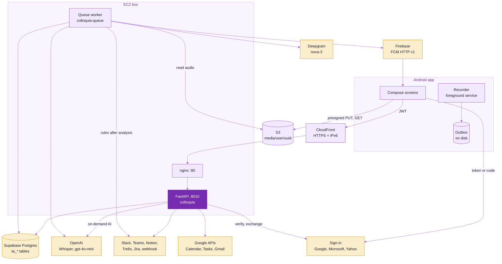
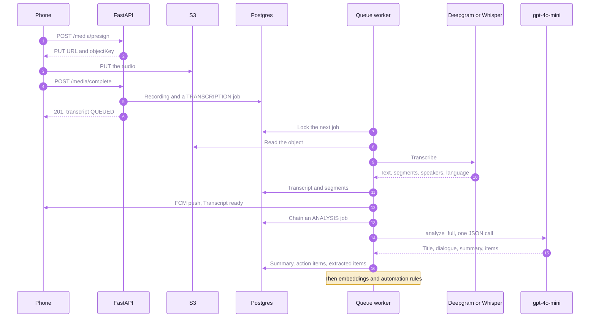
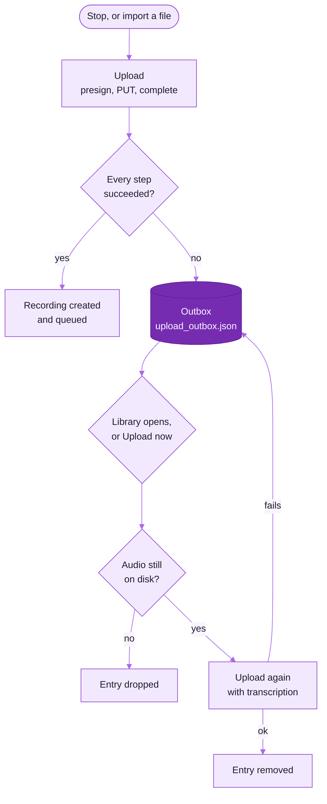
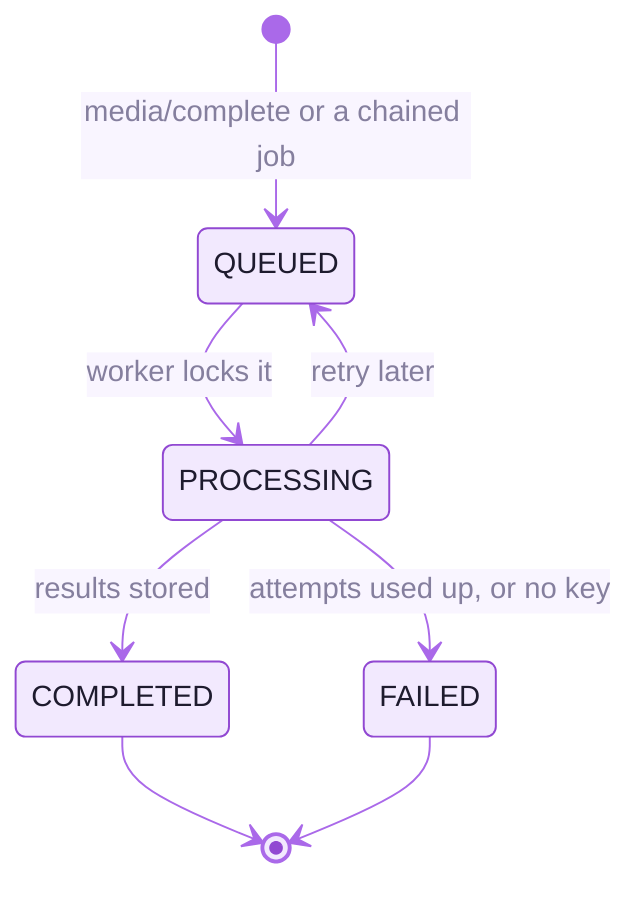
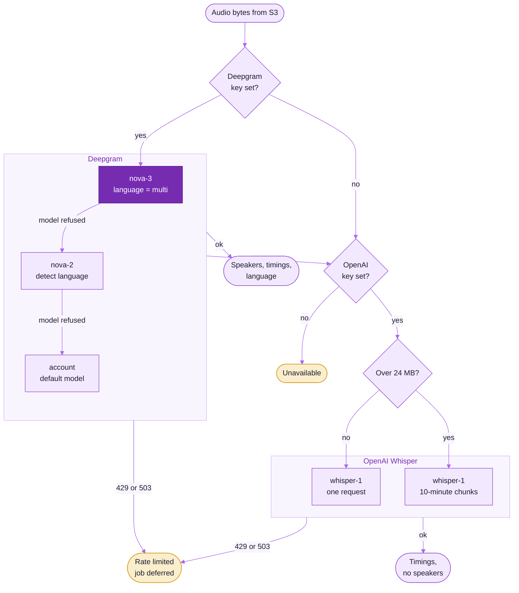
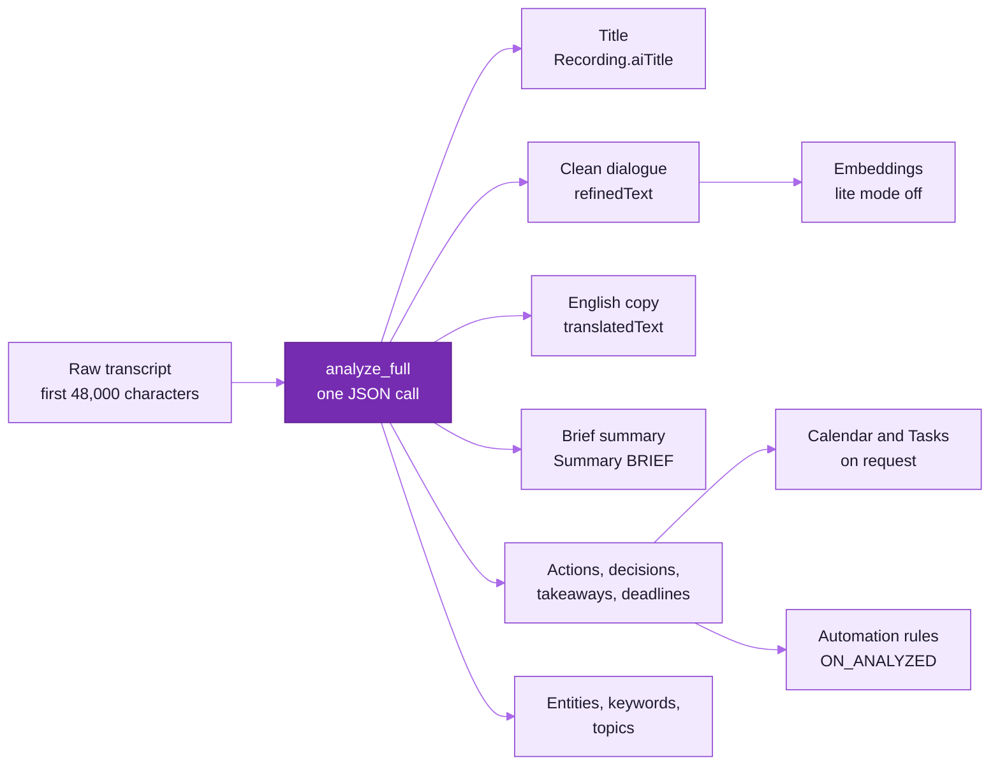
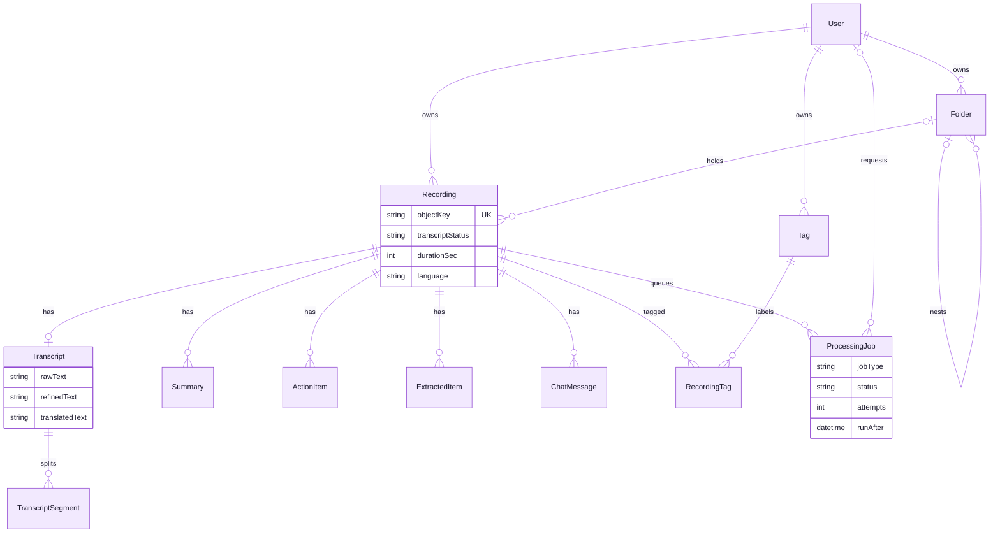
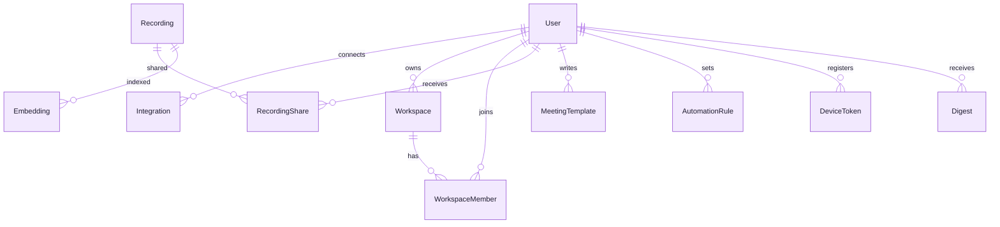

<picture>
  <source media="(prefers-color-scheme: dark)" srcset="readme-kit/assets/divider-dark.svg">
  
</picture>

# &nbsp; Architecture

Colloquia is API first: an Android client and a FastAPI backend that speak JSON over HTTPS with a JWT.
The slow work, transcription and AI analysis, is taken off the request path by a durable job queue in
Postgres that one worker drains, so a small EC2 box stays responsive while it transcribes.

| Section | What it covers |
|---|---|
| [1. System context](#1-system-context) | every moving part and who talks to whom |
| [2. From recording to transcript](#2-from-recording-to-transcript) | the upload and the two queue jobs, step by step |
| [3. The offline outbox](#3-the-offline-outbox) | what the phone does when an upload fails |
| [4. The queue](#4-the-queue) | job states, retries, rate limits and the off-peak window |
| [5. Transcription providers](#5-transcription-providers) | Deepgram first, Whisper as the fallback |
| [6. Analysis](#6-analysis) | the one AI call and what it writes |
| [7. Data model](#7-data-model) | the `ta_*` tables and how they relate |
| [8. Configuration](#8-configuration) | every backend environment variable and its default |
| [9. Deployment](#9-deployment) | the deploy workflow, the systemd units and key rotation |

## 1. System context

| Part | Code | Notes |
|---|---|---|
| Recorder | `android/.../recording/RecorderController.kt`, `RecorderService.kt` | `MediaRecorder` to AAC in an `.m4a`, 128 kbps at 44.1 kHz or 64 kbps at 22.05 kHz; the voice-recognition source (the platform's noise suppression) when noise cancellation is on |
| API client | `android/.../data/ApiClient.kt`, `Api.kt` | Retrofit over OkHttp; GETs and `/media/presign` are retried up to four times on 502, 503 or 504, other writes never, so a gateway timeout cannot create a duplicate |
| API | `backend/app/main.py`, `app/api/routes/*` | everything under `/api`, plus `/health`, `/health/ai` and the WebSocket `/api/live/transcribe` |
| Worker | `backend/app/worker.py`, `app/services/media_queue.py` | a plain `asyncio` loop, no supervisor; systemd restarts it only when it exits |
| Storage | `backend/app/services/s3.py` | keys are `media/<user>/<uuid>/<file name>`, so this app and the field repository share one bucket; presigned against the dual-stack regional endpoint |
| Database | `backend/app/core/db.py`, `prisma/schema.prisma` | the field repository's Supabase database, through the transaction pooler by default |

The worker can also run inside the API process: with `MEDIA_QUEUE_WORKER_ENABLED=true` (the default),
each uvicorn process tries a host-wide file lock at start, and only the one that gets it drains the
queue. Production turns this off in the API unit and runs `colloquia-queue` instead.

## 2. From recording to transcript

- **Idempotent `/complete`.** The object key is unique, so a retried call returns the recording it
  already made, and queues its transcription if the first call died before it could. A race between two
  retries returns the row that won.
- **Imports.** A picked audio file is uploaded with the type its extension names (MP3, WAV, OGG, FLAC,
  AAC, Opus, AMR, otherwise M4A). A picked video has its audio track copied into an `.m4a` on the phone
  with `MediaExtractor` and `MediaMuxer`, without re-encoding, and only that is uploaded.
- **Multipart.** `/media/multipart/*` creates, presigns, completes and aborts S3 multipart uploads in
  64 MB parts for large files. The Android app uses the single presigned PUT.
- **Re-transcribe.** `POST /recordings/{id}/transcribe-now` skips the queue and the off-peak window and
  transcribes inside the request, then queues the analysis. A long recording can outlast CloudFront's
  60-second origin read timeout.

## 3. The offline outbox

Any exception during presign, the S3 PUT or `/media/complete` puts the recording in the outbox, a JSON
list in the app's files directory that points at the audio already on disk; only the metadata is
serialised. The phone notifies **Saved offline**, and the library shows how many recordings wait. The
outbox is flushed, in the order entries were added, each time the library screen opens and when **Upload
now** (library) or **Upload pending now** (settings) is tapped; there is no network listener.

Two edges to know. A flush uploads under a fresh object key, so if a `/complete` succeeded on the server
but its answer was lost, the retry makes a second recording. And imported files wait in the app's cache
directory, which Android may clear, while recordings wait in app storage; an entry whose file is gone is
dropped.

## 4. The queue

Every 5 seconds (`MEDIA_QUEUE_INTERVAL_SECONDS`) the worker takes up to 3 jobs (`MEDIA_QUEUE_BATCH_SIZE`)
whose `runAfter` has passed, lowest priority number first, then oldest: transcription jobs carry 50 and
analysis jobs 70. A transcription job is only taken when the off-peak window allows it (always, unless the
master admin turned the window on; then only inside it, 02:00 to 05:00 Asia/Kolkata by default) or the
box is idle (one-minute load under 0.6 per CPU), and no rate-limit cooldown is running. Analysis jobs
ignore both gates.

| Case | What happens | Attempt spent |
|---|---|:---:|
| Deepgram or OpenAI answers 429 or 503 after the in-call retries | the job waits for `Retry-After`, or 30 s; new transcriptions pause for `Retry-After` or a cooldown that doubles from 30 s up to 15 minutes, cleared by the next successful transcription | · |
| OpenAI is out of quota during analysis | the job waits 15 minutes and tries again, as long as it takes; new transcriptions pause for the same 15 minutes | · |
| Any other error | the job waits 1, 2, 4 minutes and so on, at most 60, until `MEDIA_QUEUE_JOB_MAX_ATTEMPTS` (3) is reached, then `FAILED` | ✓ |
| The worker died holding a job | after 30 minutes the job is put back in the queue | ✓ |
| No Deepgram or OpenAI key for a transcription | the job is `FAILED` at once and the recording `UNAVAILABLE` | ✓ |

Inside one call, every Deepgram and OpenAI request retries 429 and 5xx up to four times with jittered
backoff of at most 8 seconds, honouring `Retry-After`. Out-of-quota, 401 and 403 are never retried. The
cooldown lives in the worker's memory, which is safe because only one worker drains the queue, and a
restart clears it.

The recording's `transcriptStatus` follows its job:

| `transcriptStatus` | Means |
|---|---|
| `PENDING` | uploaded without asking for a transcript |
| `QUEUED` | a job waits, or was deferred by a rate limit |
| `PROCESSING` | the worker is on it |
| `COMPLETED` | the transcript is stored, even an empty one |
| `FAILED` | the last attempt failed; the job may still retry while attempts remain |
| `UNAVAILABLE` | no speech provider key was configured |

## 5. Transcription providers

- **Deepgram** (`/v1/listen`, with diarisation, punctuation, utterances and smart formatting) is called
  whenever `DEEPGRAM_API_KEY` is set. nova-3 with `language=multi` handles code-switching across
  English, Spanish, French, German, Hindi, Russian, Portuguese, Japanese, Italian and Dutch and tags
  each utterance with its language. A 400, 403 or 404 means the account lacks that model, so the next
  set is tried. Each utterance becomes a segment labelled `Speaker 1`, `Speaker 2` and so on; the
  recording's language is the channel's detected language, or the most frequent utterance tag.
- **Whisper** (`whisper-1`, `verbose_json` with segment timestamps) is the fallback for any other
  Deepgram error and the only engine when no Deepgram key is set. A file over 24 MB is decoded with
  pydub and ffmpeg and cut into ten-minute mono MP3 chunks at 64 kbps, sent one after another, and the
  segments are shifted by each chunk's start. If the audio cannot be decoded it is sent whole.
- **Speakers without Deepgram.** Whisper segments carry no speaker. The analysis pass writes the clean
  dialogue with consistent **Speaker N** labels, which is what the Conversation tab shows.

## 6. Analysis

A whole recording's analysis is one `gpt-4o-mini` request in JSON mode, which replaced five separate
calls that ran through tight per-minute quotas. The prompt asks the model to stay faithful to the source,
and carries the current date and time in `APP_TIMEZONE` so relative dates become ISO due dates. A re-run
replaces the action and extracted items rather than adding to them. The AI title replaces the display
title only while that still starts with "Recording" or "New recording".

| Transcript mode | What the analysis writes | Set by |
|---|---|---|
| `REFINED_TRANSLATED` | the clean dialogue, plus an English copy when the source is not English | the master admin, in settings |
| `REFINED` | the clean dialogue in its own language | |
| `RAW` | the same as `REFINED` today; the worker only tells the two English choices apart | |

The worker assumes `REFINED_TRANSLATED` until the settings row exists; the row is created with
`REFINED` the first time any client reads `/settings`.

On demand, the routes in `app/api/routes/ai.py` and `insights.py` write detailed, bullet and minutes
summaries, answer chat (kept as `ChatMessage` rows), translate, rewrite, change tone, run a custom prompt,
coach, analyse the conversation and write a daily or weekly digest, each with the same model and a cap
of 48,000 characters. Semantic search embeds segments three at a time with `text-embedding-3-small` and
ranks by cosine similarity in Python; with `LITE_MODE` on, nothing is embedded and search matches
keywords instead.

## 7. Data model

Colloquia shares the field repository's Postgres database. To stay out of its way, every model is mapped
to a `ta_*` table, and every status, role and kind column is a plain `String` rather than a Prisma enum,
because an enum creates a Postgres type that could collide with the other app's.

The second set of tables, added for integrations, collaboration, knowledge and automation, keeps the
user or recording id in a plain column. Only `WorkspaceMember` to `Workspace` is a foreign key in the
database.

| Model | Table | Holds |
|---|---|---|
| `User` | `ta_users` | email, name, bcrypt hash, role (`MASTER_ADMIN`, `ADMIN`, `USER`), sign-in provider, settings JSON |
| `Recording` | `ta_recordings` | the S3 object (unique `objectKey`), status, `transcriptStatus`, favourite, archive and pin flags, folder |
| `Transcript` | `ta_transcripts` | raw text, clean dialogue, English copy, language, model, duration |
| `TranscriptSegment` | `ta_transcript_segments` | index, speaker, start and end in ms, text, and an `editedText` that leaves the original untouched |
| `Summary` | `ta_summaries` | one per recording and type: `BRIEF`, `DETAILED`, `BULLETS`, `MINUTES` |
| `ActionItem` | `ta_action_items` | kind `ACTION`, `DECISION`, `TAKEAWAY` or `DEADLINE`, assignee, due date, done |
| `ExtractedItem` | `ta_extracted_items` | kind `ENTITY`, `KEYWORD` or `TOPIC` |
| `ChatMessage` | `ta_chat_messages` | role `USER` or `ASSISTANT` |
| `ProcessingJob` | `ta_processing_jobs` | job type, status, priority, attempts, `runAfter`, lock, result JSON |
| `AppSetting` | `ta_app_settings` | one row, id `singleton`: transcript mode, off-peak window and timezone, optional Deepgram and OpenAI key overrides |
| `AppRelease` | `ta_app_releases` | APKs published for over-the-air updates |
| `Integration` | `ta_integrations` | one per user and provider, with its config JSON |
| `Workspace`, `WorkspaceMember` | `ta_workspaces`, `ta_workspace_members` | member roles `OWNER`, `EDITOR`, `VIEWER` |
| `RecordingShare` | `ta_recording_shares` | a share to another user, tier `VIEW`, `COMMENT` or `EDIT` |
| `MeetingTemplate` | `ta_meeting_templates` | an ordered list of labelled prompts |
| `AutomationRule` | `ta_automation_rules` | trigger and action, with config |
| `Embedding` | `ta_embeddings` | a JSON float vector per group of segments; no pgvector |
| `DeviceToken` | `ta_device_tokens` | FCM tokens, deleted when FCM rejects one |
| `Digest` | `ta_digests` | `DAILY` or `WEEKLY` recaps |

Tables are created by the SQL files in `backend/prisma/`, applied with `prisma db execute` in this
order: `create_tables.sql`, `phase2_tables.sql`, `app_release_table.sql`,
`alter_transcript_translated.sql`, `alter_appsetting_keys.sql`. Never `prisma db push`, which fails here
with P1014, and never `prisma migrate`, which would touch the shared `_prisma_migrations`.
`Transcript.model` records `OPENAI_TRANSCRIPTION_MODEL` even when Deepgram did the transcribing.

## 8. Configuration

The backend reads `backend/.env` through Pydantic Settings; `backend/.env.example` is the template.

| Variable | Default | What it does |
|---|---|---|
| `DATABASE_URL` | required | the Supabase Postgres URL |
| `DATABASE_USE_TRANSACTION_POOLER` | `true` | rewrite the URL to the transaction pooler on `:6543` with `pgbouncer=true` |
| `DATABASE_CONNECTION_LIMIT`, `DATABASE_POOL_TIMEOUT` | `10`, unset | Prisma's pool size and wait |
| `JWT_SECRET` | required | signs the HS256 session tokens |
| `JWT_EXPIRES_MINUTES` | `10080` | seven days |
| `AWS_ACCESS_KEY_ID`, `AWS_SECRET_ACCESS_KEY`, `AWS_S3_BUCKET` | required | the bucket and the keys that presign for it |
| `AWS_REGION` | `us-east-1` | presigns against `s3.dualstack.<region>.amazonaws.com` |
| `AWS_S3_ENDPOINT`, `AWS_S3_PUBLIC_BASE_URL` | unset | an S3-compatible endpoint such as MinIO; the base for stored URLs |
| `APP_URL`, `BACKEND_CORS_ORIGINS` | `http://localhost:3000` | CORS origins, comma-separated |
| `GOOGLE_CLIENT_ID`, `GOOGLE_ANDROID_CLIENT_ID` | unset | the audiences a Google ID token may carry |
| `MICROSOFT_CLIENT_ID`, `MICROSOFT_CLIENT_SECRET`, `MICROSOFT_TENANT` | unset, unset, `common` | Microsoft sign-in |
| `YAHOO_CLIENT_ID`, `YAHOO_CLIENT_SECRET` | unset | Yahoo sign-in |
| `MASTER_ADMIN_EMAIL`, `MASTER_ADMIN_NAME` | empty, `Admin` | the address that signs in as master admin |
| `ADMIN_EMAIL`, `ADMIN_NAME`, `ADMIN_PASSWORD` | read by `seed_admin.py` only | the seeded account |
| `OPENAI_API_KEY` | unset | Whisper, analysis, chat and embeddings |
| `OPENAI_TRANSCRIPTION_MODEL`, `OPENAI_CHAT_MODEL`, `OPENAI_EMBEDDING_MODEL` | `whisper-1`, `gpt-4o-mini`, `text-embedding-3-small` | |
| `DEEPGRAM_API_KEY` | unset | Deepgram first when set |
| `DEEPGRAM_MODEL`, `DEEPGRAM_LANGUAGE` | `nova-3`, `multi` | the first Deepgram attempt |
| `APP_TIMEZONE` | `Asia/Kolkata` | the "now" the AI resolves dates against |
| `MEDIA_QUEUE_WORKER_ENABLED` | `true` | run the queue inside the API; the production API unit sets `false` |
| `MEDIA_QUEUE_INTERVAL_SECONDS`, `MEDIA_QUEUE_BATCH_SIZE`, `MEDIA_QUEUE_JOB_MAX_ATTEMPTS` | `5`, `3`, `3` | |
| `LITE_MODE` | `true` | skip embeddings and refuse live transcription, for a small box |
| `FCM_SERVICE_ACCOUNT_FILE` | unset | the Firebase service-account JSON; without it device tokens are kept and nothing is sent |

`.env.example` still lists `FCM_SERVER_KEY`, the legacy FCM key, which the backend no longer reads.

## 9. Deployment

```mermaid
%%{init: {"theme":"base","fontFamily":"Inter, ui-sans-serif, system-ui, -apple-system, Segoe UI, Roboto, Helvetica, Arial, sans-serif","themeVariables":{"fontSize":"15px","primaryColor":"#F2E9FE","primaryTextColor":"#1E1B2E","primaryBorderColor":"#9148D2","secondaryColor":"#FAEECD","secondaryTextColor":"#1E1B2E","secondaryBorderColor":"#CD9200","tertiaryColor":"#F3F1FA","tertiaryTextColor":"#1E1B2E","tertiaryBorderColor":"#A7A3BC","mainBkg":"#F2E9FE","nodeBorder":"#9148D2","nodeTextColor":"#1E1B2E","lineColor":"#AA69E9","textColor":"#857F9E","edgeLabelBackground":"#F9F5FF","clusterBkg":"#F9F5FF","clusterBorder":"#D6B6FB","titleColor":"#762CB1","noteBkgColor":"#FAEECD","noteTextColor":"#1E1B2E","noteBorderColor":"#CD9200","actorBkg":"#F2E9FE","actorBorder":"#9148D2","actorTextColor":"#1E1B2E","actorLineColor":"#AA69E9","signalColor":"#AA69E9","signalTextColor":"#857F9E","labelBoxBkgColor":"#F2E9FE","labelBoxBorderColor":"#9148D2","labelTextColor":"#1E1B2E","loopTextColor":"#857F9E","activationBkgColor":"#E7D5FE","activationBorderColor":"#9148D2","sequenceNumberColor":"#FFFFFF","transitionColor":"#AA69E9","transitionLabelColor":"#857F9E","stateLabelColor":"#1E1B2E","stateBkg":"#F2E9FE","compositeBackground":"#F9F5FF","compositeTitleBackground":"#F2E9FE","attributeBackgroundColorOdd":"#FFFFFF","attributeBackgroundColorEven":"#F9F5FF","relationColor":"#AA69E9","relationLabelBackground":"#F9F5FF","relationLabelColor":"#1E1B2E"}}}%%
flowchart LR
  P([Push to main]) --> CI["ci.yml<br/>import check, debug APK"]
  P -->|backend changed| DB["deploy-backend.yml"]
  DB --> RS["rsync backend/<br/>to the box"]
  RS --> EV["Write .env and<br/>the FCM key file"]
  EV --> UN["Rewrite both<br/>systemd units"]
  UN --> SQL["Stop, apply the<br/>ta_* SQL files"]
  SQL --> RE["Restart API<br/>and queue"]
  RE --> H{"Health<br/>in 80 s?"}
  H -->|yes| OK([Deployed])
  H -->|no| F["Fail, print<br/>the journal"]
  TF["Terraform"] -->|provisions| BOX["EC2, Elastic IP,<br/>CloudFront"]
  classDef accent fill:#762CB1,stroke:#5F1C93,color:#FFFFFF
  classDef gold fill:#FAEECD,stroke:#CD9200,color:#1E1B2E
  class DB accent
  class TF,BOX gold
```

| On the box | Runs | Why it is set up this way |
|---|---|---|
| `colloquia.service` | `uvicorn app.main:app --host 127.0.0.1 --port 8010 --workers 1`, with `MEDIA_QUEUE_WORKER_ENABLED=false` | with two workers, uvicorn's supervisor killed a worker whose health ping starved during a transcription, orphaning its Prisma engine until the Supabase pooler was full and every DB call failed |
| `colloquia-queue.service` | `python -m app.worker` | `KillMode=control-group` reaps its query engine on stop, and the long work never shares a process with requests |
| nginx | port 80 to `127.0.0.1:8010` | bodies up to 200 MB, a 300-second read timeout |

The deploy writes the units itself, so a box provisioned before this split is repaired on its next deploy.
It stops both services before applying the SQL files, so the API releases its pooler sessions first, and
ignores errors from tables that already exist. The box keeps no state: the database is on Supabase and
the audio on S3, so it can be rebuilt from `infra/terraform` at any time. Terraform generates the deploy
key pair and writes the private key beside it as `colloquia-deploy.pem`, which is git-ignored, as are
state files and `*.tfvars`.

**Rotating keys.** `BACKEND_ENV` is written whole on every deploy. The optional secrets `OPENAI_API_KEY`,
`MICROSOFT_*` and `YAHOO_*` each replace their own line, and only when set, so rotating the OpenAI key
is one secret and a re-run. Without a deploy at all, a Deepgram or OpenAI key written to
`ta_app_settings.deepgramApiKey` or `openaiApiKey` wins over the environment the next time the queue or
an AI route resolves its settings; a restart also clears the worker's in-memory cooldown. See
[backend/DEPLOY_NOTES.md](../backend/DEPLOY_NOTES.md) and [infra/CLOUDFRONT.md](../infra/CLOUDFRONT.md).

<picture>
  <source media="(prefers-color-scheme: dark)" srcset="readme-kit/assets/footer-dark.svg">
  
</picture>
